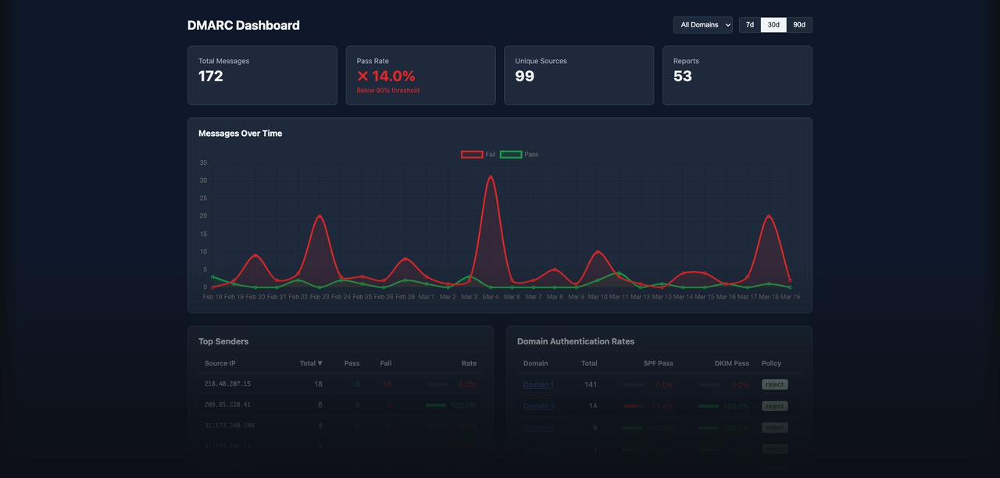

# DMARC Dashboard Kit

This project is born out of the frustration against expensive DMARC analytics services that individuals can't afford.

A self-hosted DMARC report analyzer on Cloudflare's free tier. One deploy script sets up everything: email ingestion, database, dashboard, and access control.

```
Email Sender → Cloudflare Email Routing → Worker email() → D1 (SQLite)
                                          Worker fetch()  → Dashboard (Svelte)
                                          Cloudflare Access (login wall)
```

A single Cloudflare Worker handles both DMARC report ingestion (via email) and serves the dashboard + API. Cloudflare Access protects the entire application.

## Prerequisites

- [Node.js](https://nodejs.org/) 22.18 or later (required by the `cf` CLI)
- [pnpm](https://pnpm.io/) 12
- [jq](https://jqlang.org/)
- A Cloudflare account with a domain (free plan works)

No API token is needed: `deploy.sh` logs in through the `cf` CLI, requesting only the permissions it uses. On the consent screen, select only the account(s) the kit should manage — logins are account-scoped, not zone-scoped.

## One-Time Prerequisite

**Set up Cloudflare Zero Trust** on your account, which provides Cloudflare Access (the dashboard's login wall):
> Cloudflare Dashboard → Zero Trust → Get started — choose a team name and the Free plan

This is an account-level choice, so deploy does not do it; it stops with these steps if Zero Trust is missing.

Email Routing needs no manual step. Deploy enables it on the receiving domain when that domain has no MX records yet. It never enables it over another mail provider's MX records — if your zone already receives mail elsewhere, choose a receiving subdomain in `--setup` (it suggests this), or use a dedicated domain.

## Quick Start

```bash
git clone https://github.com/richardevs/dmarc-dashboard-kit.git
cd dmarc-dashboard-kit
pnpm install
bash deploy.sh
```

On first run, deploy walks you through creating `profiles/default.json`: it logs in, lists your accounts and zones to pick from, suggests a receiving subdomain when the zone already has a mail provider, and pre-fills the Access email from your login. **`--setup` is the only way to change a profile:** run `bash deploy.sh [--profile <name>] --setup` again and press Enter to keep each current value. Profiles carry a checksum, and deploy refuses one that was edited by hand until it is saved through `--setup` again. [`profiles/example.json`](profiles/example.json) shows a complete profile for reference. The fields:

| Field | Meaning |
|-------|---------|
| `cfLogin` | Named `cf` login to use (empty = the default login) |
| `accountId` | Cloudflare account (needed when your login can see several) |
| `zone` | Zone (domain) that receives reports and hosts the dashboard |
| `dmarc.localPart`, `dmarc.subdomain` | Receiving address `<localPart>@<subdomain>.<zone>`; an empty subdomain receives on the zone itself |
| `dmarc.authorizedDomains` | Other domains allowed to send reports here; empty = any (wildcard) |
| `dashboard.host` | Dashboard hostname, exactly one level below the zone (also when receiving on a subdomain), so the zone's Universal SSL certificate covers it; empty = generated once as `dmarc-<random>.<zone>` and saved |
| `access.*` | Who may open the dashboard: emails / email domains (OR'd), IP ranges (AND'd with identity when both are set) |
| `access.sessionDuration` | How long an Access login lasts (15m, 30m, 6h, 12h, 24h, 168h = 1 week, 730h = 1 month; default 24h). A session duration set on the policy or globally in Zero Trust overrides it |

After saving, setup offers to deploy right away.

### Multiple profiles

Each `profiles/<name>.json` is a separate deployment (for example, personal and company accounts): `bash deploy.sh --profile company`. In `--setup`, pick (or create) a separate Cloudflare login for each profile.

### Sharing a profile in a team

Profiles hold no credentials — each person logs in with their own Cloudflare account (`--login`), which needs access to the profile's account. To share a deployment's settings, commit the profile in your internal copy of the repo: add `!profiles/company.json` to `.gitignore` (or `git add -f profiles/company.json`). For automated deploys, `cf` also accepts a `CLOUDFLARE_API_TOKEN` from the environment, kept in your CI's secret store.

### Upgrading from `.env`

Just run `bash deploy.sh`: an existing `.env` is converted into `profiles/default.json` and, after you confirm, moved to `.env.legacy` (`cf` would otherwise read its token). Review the result with `bash deploy.sh --setup`, then deploy. A leftover `wrangler.toml` is no longer used; compare it with `cloudflare.config.ts`, then remove it.

## What Deploy Automates

| Step | What |
|------|------|
| 0 | Resolves the zone, checks Email Routing (enables it on a receiving subdomain) |
| 1 | Cloudflare Access app + reusable policy for the dashboard host (before it goes live) |
| 2 | Finds or creates the D1 database (`dmarc-reports`) |
| 3 | Applies D1 migrations |
| 4 | Builds the Svelte dashboard |
| 5 | Deploys the worker on a route for the dashboard host (`workers.dev` and preview URLs off) |
| 6 | Email routing rule → worker |
| 7 | `_report._dmarc` TXT records (tagged `managed-by:dmarc-dashboard-kit`) |

The dashboard runs on a Worker route behind a proxied DNS record, so the zone's Universal SSL wildcard serves it. A Workers custom domain would get its own certificate, which publishes the hostname in public Certificate Transparency logs. Changing `dashboard.host` later is safe: deploy removes the previous host's DNS record before Access moves to the new host, so the old name never serves the dashboard without Access.

### Checking a deployment

```bash
bash deploy.sh [--profile <name>] --list     # settings, managed resources, login scopes
bash deploy.sh [--profile <name>] --verify   # compare the live setup with the profile
```

`--verify` checks every resource the script manages, confirms the dashboard answers only through Access and is served by the zone's wildcard certificate, and reports leftovers from older versions (old `.env`/`wrangler.toml`, routing rules or DNS records on zones the profile no longer uses). It exits non-zero when something is wrong.

### Cleanup and removal

```bash
bash deploy.sh [--profile <name>] --cleanup   # leftovers only
bash deploy.sh [--profile <name>] --destroy   # the whole deployment
```

`--cleanup` lists only **leftovers**: resources this script created that the profile no longer uses, such as the routing rule and `_report._dmarc` records on a zone you moved away from, or records of domains you removed from the list. Tick the ones to delete. The live deployment never appears in this list.

`--destroy` removes the **whole deployment** of the profile: worker, Access, routing rules and DNS records (leftovers included) — all things a deploy can rebuild. The D1 database is the exception: destroy shows how many reports it holds and deletes it only when you type its name; press Enter to keep it (copy the reports first with `--migrate-from` if you need them).

Confirmations take exactly `Y` or `N` and ask again on anything else.

### Moving reports between deployments

```bash
bash deploy.sh --profile company --migrate-from=default
```

Copies all stored reports from the `default` profile's database into `company`'s, using each profile's own login (so it works across accounts). Reports already present are skipped, so it is safe to re-run.

## Multi-Domain Support

To monitor a domain, two DNS records are needed:

**1. On the monitored domain**:
```
_dmarc.otherdomain.com  TXT  "v=DMARC1; p=none; rua=mailto:rua@yourdomain.com"
```

**2. On your receiving domain** (authorizes accepting reports):
```
otherdomain.com._report._dmarc.yourdomain.com  TXT  "v=DMARC1;"
```

The deploy script handles step 2 automatically:
- List the domains you monitor in `--setup` (step 5, authorized domains)
- Or leave the list empty to create a wildcard `*._report._dmarc` that accepts reports from any domain

Records the script created are tagged with a DNS comment, so removing a domain from the list also removes its record on the next deploy.

The receiving address is public (it is in every monitored domain's `rua=`), so anyone can send it reports. With authorized domains listed, the worker keeps only reports whose policy domain is your zone, one of the listed domains, or a subdomain of them, and drops the rest (logged as "domain not allowed"). With the list empty, reports for any domain are kept.

With the domains listed, deploy and `--verify` also check each domain's published DMARC record: whether its policy is still `p=none`, and whether its `rua=` really includes your receiving address.

> **Warning:** `p=none` only monitors — it does **not** block spoofed emails. Once you've reviewed your DMARC reports and confirmed all legitimate senders pass DKIM/SPF, move to `p=quarantine` and then `p=reject` as soon as possible.

## Sender IP details

"Show Details" in the senders table adds each IP's country and network owner. Deploy downloads the free [DB-IP Lite](https://db-ip.com/db/lite.php) country and ASN databases (CC BY 4.0, refreshed monthly, cached in `.cache/dbip/`) into the dashboard's static assets, and the worker looks IPs up locally — no external API, token, or rate limit, and sender IPs never leave Cloudflare. The dashboard shows the required "IP Geolocation by DB-IP" credit.

## Receiving on a subdomain

Choose "A subdomain" in `--setup` (step 4; e.g. `dmarc` for `rua@dmarc.example.com`) when the zone root already receives mail through another provider. Deploy enables Email Routing on the subdomain only, and refuses if the subdomain already receives mail elsewhere. Cloudflare then adds MX and SPF records under the subdomain and a `cf2024-1._domainkey` DKIM key at the root; the root's MX and SPF records stay as they are. If the root receives mail elsewhere but has no SPF record, deploy stops: Cloudflare would add a root SPF record authorizing only itself, breaking SPF for the root's own mail.

To stop receiving on the subdomain, remove it in the dashboard (zone → Email → Email Routing → Settings → Subdomains); this needs a permission the deploy login does not request, so `--cleanup` only reminds you.

## Changing the Receiving Domain

**On the same Cloudflare account**, change the zone of the existing profile; the worker, D1 database, Access, and **all stored reports** stay as they are, so nothing needs copying:

1. Add the new zone to Cloudflare.
2. Run `bash deploy.sh --setup` and pick the new zone and a dashboard hostname in it (or let one be generated).
3. Run `bash deploy.sh`. The old dashboard host is retired automatically.
4. Point each monitored domain's `rua=` at the new address.

Keep the old zone's routing rule for **1–2 weeks** so in-flight reports still arrive — `bash deploy.sh --verify` lists it under leftovers meanwhile — then run `bash deploy.sh --cleanup`: it lists the old zone's routing rule and DNS records as leftovers.

**On a different Cloudflare account** (for example, moving from a personal to a company account), create a new profile for that account with `bash deploy.sh --setup`, deploy it, and copy the stored reports across with `bash deploy.sh --profile <new> --migrate-from=<old>` (see [Moving reports between deployments](#moving-reports-between-deployments)). Two profiles on the same account would share one worker and database, so use this only across accounts.

## Local Development

```bash
# Run D1 migrations locally
pnpm run migrate:local

# Start worker dev server (API + email handler)
pnpm run dev

# In another terminal — start dashboard dev server
pnpm --filter dashboard run dev
```

A pre-commit hook (`.githooks/`, enabled by `pnpm install`) scans staged changes for secrets with [betterleaks](https://betterleaks.com) when it is installed; `pnpm run scan:secrets` scans the whole git history.

The repo is a pnpm workspace: `pnpm install` at the root installs the worker and the dashboard, and `pnpm update -r` updates both (a plain `pnpm update` only updates the root; `pnpm run update:all` does the same).

The dashboard dev server (Vite) runs separately during development. In production, the built dashboard is served as static assets by the worker. Sender IP details work locally only after a deploy has downloaded the DB-IP databases into `dashboard/dist/_geo/`.

## Project Structure

```
├── src/                    # Cloudflare Worker
│   ├── index.ts            # Entry: email() + fetch() handlers
│   ├── email-handler.ts    # Email → parse XML → D1
│   ├── api.ts              # /api/* routes
│   ├── db.ts               # D1 queries
│   ├── geo.ts              # Sender IP country/network lookup (DB-IP Lite)
│   └── types.ts            # TypeScript types + DMARC enums
├── dashboard/              # Svelte SPA
│   └── src/
│       ├── App.svelte
│       ├── components/     # SummaryCards, Charts, Tables
│       └── lib/api.ts      # API client
├── migrations/
│   ├── 0001_init.sql       # D1 schema (reports + record_rows tables)
│   └── 0002_record_rows_unique.sql  # unique index on record_rows
├── profiles/example.json   # Example profile for reference (real profiles are created by --setup and gitignored)
├── cloudflare.config.ts    # Worker config (reads the selected profile)
├── wrangler.config.ts      # Build settings (dashboard assets directory)
├── .githooks/pre-commit    # betterleaks secret scan (enabled by pnpm install)
├── CHANGELOG.md            # Every user-facing change, per release
└── deploy.sh               # Deploy and manage: --setup, --list, --verify, --cleanup, --migrate-from
```

## License

MIT — see [LICENSE](LICENSE). Portions adapted from Cloudflare's [dmarc-email-worker](https://github.com/cloudflare/dmarc-email-worker).
